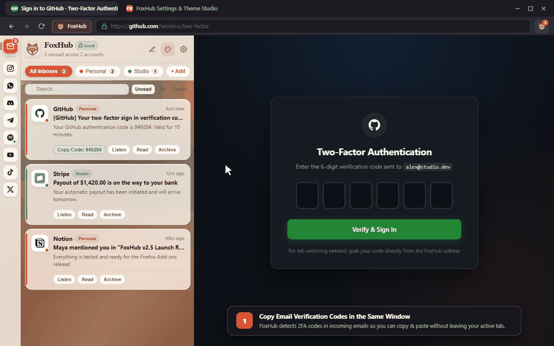

# FoxHub for Firefox

<p align="center">
  
</p>

<p align="center">
  <a href="https://addons.mozilla.org/firefox/addon/foxhub-firefox-sidebar/"><strong>Install on Firefox Add-ons (AMO)</strong></a> · <strong>v2.8.0</strong> · <strong>100% Local &amp; Open Source (MPL-2.0)</strong>
</p>

**FoxHub** is a local multi-account Gmail inbox and Opera GX-style social, AI & media sidebar web panel built for Firefox.

Instead of keeping ten pinned tabs open just to grab login verification codes, reply to messages, change a song, ask an AI assistant, or scroll Reels while working, FoxHub keeps your inbox and web apps tucked cleanly in the Firefox sidebar, toolbar popup, or a standalone popout window right next to your active tab.



> Full high-res video: [`demo/foxhub-demo.mp4`](demo/foxhub-demo.mp4)

## Why I Built This

1. **Copying email verification codes in the same window:** Whenever a site asks for a 6-digit login code, FoxHub detects the code inside incoming emails and gives you a one-click **Copy** button right in the sidebar. You grab the code and paste it into the page next to it without switching tabs.
2. **Social, AI & media apps that actually fit a sidebar:** Most desktop websites break or overflow horizontally when squeezed into a 380px sidebar. FoxHub automatically adapts layouts for **21 built-in web apps** (**Instagram**, **WhatsApp**, **Discord**, **Telegram**, **Spotify**, **YouTube**, **TikTok**, **X**, **Messenger**, **Reddit**, **Twitch**, **ChatGPT**, **Google Gemini**, **Claude**, **Perplexity**, **SoundCloud**, **Apple Music**, **Bluesky**, **Notion**, **Google Calendar**, and **Google Keep**) plus unlimited custom apps with per-app Mobile/Desktop User-Agent overrides and a clean bottom navigation bar.
3. **Opera GX-style Mini Now Playing Bar, smart audio priority & instant switching:** Control background **Spotify**, **YouTube**, **SoundCloud**, and **Apple Music** from anywhere with a compact Mini Now Playing bar (movable seek scrubber, interactive volume slider & mute/restore, prev/play/next, and paused close button). Foreground apps (like Instagram Reels) automatically take priority over background music, and external Firefox tabs auto-pause & auto-resume music right where it left off.
4. **Security & privacy first (100% local, zero telemetry):** There are no external developer servers, no analytics scripts, and no data collection. Everything runs locally on your machine between Firefox and the sites you already use.

## Main Features

* **Multi-Account Gmail Inbox & 1-Click 2FA Code Copier:** Automatically picks up all signed-in Firefox Google accounts (`u/0`, `u/1`, `u/2`, etc.) in a unified inbox or per-account tabs. Extracts 4–8 digit codes, alphanumeric codes, `G-XXXXXX` codes, and hyphenated activation/Steam keys (`XXXXX-XXXXX-XXXXX`) from the newest thread message, and supports quick reply, archive, delete, star, snooze, and Text-to-Speech.
* **21 Built-In Sidebar Web Apps + Custom Pro Apps:** Core social & media panels plus **AI & Productivity** presets (**ChatGPT**, **Google Gemini**, **Claude**, **Perplexity**, **SoundCloud**, **Apple Music**, **Bluesky**, **Notion**, **Google Calendar**, **Google Keep**, **Twitch**), custom app creation/editing (custom icon upload, accent color, Mobile/Desktop User-Agent mode), and right-click **"Open in FoxHub Sidebar"** context menus for pages and links.
* **Mini "Now Playing" Bar & Persistent Volume Control:** Compact Opera GX/Arc-style bottom player bar with an interactive top-edge seek scrubber knob, inline volume slider & mute/restore button (synced and persisted per app across reopen/refresh/track changes), skip/play controls, and a paused-only close (`×`) button.
* **Quick Switcher (`Ctrl+K` / `Cmd+K`):** Spotlight-style command palette to jump instantly to any pinned or unpinned app, open an ad-hoc URL in the sidebar, or toggle Night Mode and Quick Mute from the keyboard.
* **Smart Audio Priority & External Tab Auto-Pause:** Automatically prioritizes your selected foreground sidebar app (e.g., Instagram Reels pauses background Spotify, never vice versa) and auto-pauses/auto-resumes sidebar music when an external Firefox tab plays audio (*Pause & Resume*, *Pause Only*, or *Play Together*).
* **Seamless Background Audio Keep-Alive:** Keeps **Spotify** (with gapless playlist transitions, forward-only timestamp continuity, and multi-minute anti-throttling), **YouTube**, and **SoundCloud** playing smoothly even when FoxHub is closed or Firefox is minimized.
* **Redesigned Searchable Settings, Backup/Restore & `userChrome.css` Helper:** Live-searchable categorized Settings (unified between sidebar drawer and full Options page), JSON export/import backup & restore, optional Firefox `userChrome.css` presets, customizable global & per-app keyboard shortcuts, Quick Mute timers (`15m`, `1h`, `8h`, `24h`), and **True Night OLED (`#000`)** + 8 warm themes & custom wallpapers.

## What's New in v2.8.0

* **Mini "Now Playing" Bar with Movable Scrubber & Volume Control:**
  * Added an interactive bottom Mini Now Playing bar with a movable top-edge seek scrubber knob, inline volume slider + mute/unmute (restoring your previous volume level), previous/play/next buttons, and a paused-only close (`×`) button so the bar stays handy when paused.
  * Per-app volume and mute settings are persisted across sidebar close/reopen, iframe refresh, and song transitions—never resetting to 100%.
* **Major Spotify & Background Audio Stability Overhaul:**
  * Eliminated silence/muting across sidebar close/reopen handoffs, fast reopens, and song boundaries while keeping Spotify playing continuously even in Connect remote-control mode.
  * Enforced forward-only timestamp alignment on reopen/refresh (no more 1–2s backward rewinds) and switched inactive media frames to off-screen anti-throttling with exponential-backoff EME license retries to prevent ~2-minute background stalls.
  * Added strict **selected-app audio priority** so watching an Instagram Reel or foreground video pauses background Spotify cleanly without ever pausing the active Reel.
* **21 Built-In Apps, Quick Switcher (`Ctrl+K`) & Context Menu Launcher:**
  * Added **Google Gemini**, **ChatGPT**, **Claude**, **Perplexity**, **SoundCloud**, **Apple Music**, **Bluesky**, **Notion**, **Google Calendar**, **Google Keep**, and **Twitch** presets, plus pro custom-app editing with per-app Mobile/Desktop User-Agent mode.
  * Added `Ctrl+K` Quick Switcher (works even inside embedded frames) and right-click **"Open in FoxHub Sidebar"** for links and pages.
* **Instagram & Spotify UI Polish:**
  * Fixed Instagram profile reel modal scrubber positioning so it anchors cleanly to the bottom of the reel immediately (zero top-half flash), hid false `"Video Has No Sound"` pills on audible reels, and contained Spotify's carousel navigation arrows cleanly inside narrow sidebars.
* **Modular Architecture, Settings Overhaul & Backup/Restore:**
  * Split background, popup, and content scripts into clean, fast modular ES modules (`tab-media-watcher.js` under 8 KB on regular tabs), unified Settings with live search, added JSON Backup/Restore & `userChrome.css` presets, and verified against **261 automated E2E tests** and strict AMO MV2 linting.

<details>
<summary>Previous Releases (v2.7.9 &amp; earlier)</summary>

* **v2.7.6–v2.7.9:** Extended WASAPI/Cubeb audio drain verification, gapless Spotify `bgNextSpPlayers` transitions, Web Audio keepalive + 1-minute alarm wake pulse, Quick Mute timed popover, customizable global & per-app keyboard shortcuts, True Night OLED (`#000`) zero-flash dark mode, and Live Audio Diagnostics Log viewer.
* **v2.6.5:** Sidebar right-click context menu, multi-message Gmail 2FA thread code extractor, interactive Reels/TikTok/Shorts video scrubber, Instagram lightbox comment/audio toggles, and Discord compact rail support.

</details>

## Privacy & Security

* **No Telemetry:** Zero tracking, zero usage metrics, and zero crash reporters.
* **No Middleman Servers:** Your emails and messages never pass through any third-party proxy or backend server.
* **Local Storage Only:** Preferences, themes, shortcuts, and local cache are stored strictly in Firefox's `browser.storage.local`. See [PRIVACY.md](PRIVACY.md) for details.

## How to Install

### Option 1: Firefox Add-ons (Official Signed Release)
Install the latest signed release directly from Mozilla Add-ons:
**[FoxHub: Gmail, Social & Media Sidebar on AMO](https://addons.mozilla.org/firefox/addon/foxhub-firefox-sidebar/)**

### Option 2: Install Packaged Add-on
Install or inspect [`foxhub-firefox.xpi`](foxhub-firefox.xpi) / [`foxhub-firefox.zip`](foxhub-firefox.zip) included in this repository (built straight from source with zero bundler or minification).

### Option 3: Load in Firefox Developer / Debugging Mode
1. Open Firefox and go to `about:debugging#/runtime/this-firefox`
2. Click **Load Temporary Add-on...**
3. Select [`manifest.json`](manifest.json) or [`foxhub-firefox.zip`](foxhub-firefox.zip) in this repository.

## Project Structure

```text
├── icons/                  # Transparent warm FoxHub icons (16px to 128px + SVG)
├── src/
│   ├── background/         # Modular Gmail sync, MSE/Widevine audio engine, tab-audio watcher, shortcuts & framing
│   ├── content/            # Lightweight <8 KB tab watcher + lazy-loaded per-app optimizers, CSS & media mirror
│   ├── popup/              # Sidebar, popup & popout UI, Mini Now Playing bar, Quick Switcher & Theme Studio
│   ├── options/            # Full-page Settings synchronized with the sidebar drawer
│   └── shared/             # Schema, shared Settings UI, themes, Gmail client & 21-app catalog
├── tests/                  # 5-tier automated Firefox E2E, adversarial hardening & AMO lint suite
├── demo/                   # Demo video (.mp4) and preview (.gif)
├── manifest.json           # Firefox WebExtension manifest (v2.8.0)
├── PRIVACY.md              # Local-first privacy policy
└── LICENSE                 # Mozilla Public License 2.0 (MPL-2.0)
```

## Feedback & Feature Requests

If you have any feedback, run into a bug, or want to see a specific app or feature added, feel free to leave a review on the [Firefox Add-ons page](https://addons.mozilla.org/firefox/addon/foxhub-firefox-sidebar/) or open an issue right here on GitHub. I read everything and actively update the extension based on what people actually use.

## License

Released under the [Mozilla Public License 2.0 (MPL-2.0)](LICENSE).
