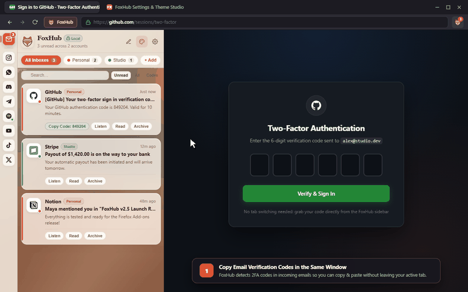

# FoxHub for Firefox

<p align="center">
  
</p>

<p align="center">
  <a href="https://addons.mozilla.org/firefox/addon/foxhub-firefox-sidebar/"><strong>Install on Firefox Add-ons (AMO)</strong></a> · <strong>v2.7.9</strong> · <strong>100% Local &amp; Open Source (MPL-2.0)</strong>
</p>

**FoxHub** is a local multi-account Gmail inbox and Opera GX-style social & media sidebar web panel built for Firefox.

Instead of keeping ten pinned tabs open just to grab login verification codes, reply to messages, change a song, or scroll Reels while working, FoxHub keeps your inbox and web apps tucked cleanly in the Firefox sidebar, toolbar popup, or a standalone popout window right next to your active tab.



> Full high-res video: [`demo/foxhub-demo.mp4`](demo/foxhub-demo.mp4)

## Why I Built This

1. **Copying email verification codes in the same window:** Whenever a site asks for a 6-digit login code, FoxHub detects the code inside incoming emails and gives you a one-click **Copy** button right in the sidebar. You grab the code and paste it into the page next to it without switching tabs.
2. **Social & media apps that actually fit a sidebar:** Most desktop websites break or overflow horizontally when squeezed into a 380px sidebar. FoxHub automatically adapts the layouts for **Instagram** (Feed, Reels, DMs), **WhatsApp**, **Discord**, **Telegram**, **Spotify**, **YouTube**, **TikTok**, **X**, **Messenger**, and **Reddit**, and adds a clean bottom navigation bar for jumping between sections.
3. **Opera GX-style smart music control & instant switching:** Active apps stay alive in the background while you switch between them or close the sidebar, and FoxHub automatically pauses Spotify or YouTube when a video plays in another Firefox tab—then resumes your music right where it left off.
4. **Security & privacy first (100% local, zero telemetry):** There are no external developer servers, no analytics scripts, and no data collection. Everything runs locally on your machine between Firefox and the sites you already use.

## Main Features

* **Multi-Account Gmail Inbox & 1-Click 2FA Code Copier:** Automatically picks up all signed-in Firefox Google accounts (`u/0`, `u/1`, `u/2`, etc.) in a unified inbox or per-account tabs. Extracts 4–8 digit codes, alphanumeric codes, `G-XXXXXX` codes, and hyphenated activation/Steam keys (`XXXXX-XXXXX-XXXXX`) from the newest thread message, and supports quick reply, archive, delete, star, snooze, and Text-to-Speech.
* **Opera GX-Style Sidebar Web Panels:** 10 built-in sidebar-adapted web apps (**Instagram**, **WhatsApp**, **Discord**, **Telegram**, **Spotify**, **YouTube**, **TikTok**, **X**, **Messenger**, **Reddit**) plus unlimited custom URLs, available in Firefox's left sidebar, toolbar popup, or standalone popout window.
* **Smart External Tab Audio Auto-Pause & Auto-Resume:** Automatically pauses FoxHub music (**Spotify** / **YouTube**) when a video or audio plays in another Firefox tab and resumes when that tab pauses or closes—configurable per preference (*Pause & Resume*, *Pause Only*, or *Play Together*) while ignoring muted autoplay feed videos.
* **Seamless Background Audio Keep-Alive:** Keeps **Spotify** (with gapless playlist transitions and queue panel support) and **YouTube** playing seamlessly in the background even when FoxHub is closed or Firefox is minimized, working independently even when Persistent Memory is turned off.
* **Customizable Keyboard Shortcuts:** Configure global shortcuts (`Alt+Shift+F` Popup, `Alt+Shift+M` Sidebar, `Alt+Shift+W` Popout) plus per-app shortcuts for any built-in or custom sidebar app straight from FoxHub Settings.
* **Quick Mute & Timed Mute Popover:** Mute **All**, **Email-only**, or **Sites-only** notifications indefinitely or on a preset timer (`15m`, `1h`, `8h`, `24h`) with live countdown badge.
* **True Night OLED (`#000`), Zero-Flash Social Dark Mode & 8 Warm Themes:** Choose from 8 warm palettes (*Warm Linen, Botanical Sage, Sakura Morning, Coastal Breeze, Golden Hour, Lavender Cloud, Gallery Paper, Cozy Espresso*), **True Night OLED** (`#000000`) with instant `0ms` dark-mode sync for social apps, illustrated wallpapers, or custom background uploads, plus a customizable Reels/TikTok/Shorts video scrubber bar.

## What's New in v2.7.9

* **Rock-Solid Spotify Background Audio & Track Transitions (`v2.7.6`–`v2.7.9`):**
  * Eliminated the brief pause-then-resume cycle (~5s after pausing a video in an external browser tab on Windows) via extended WASAPI/Cubeb audio drain verification and dual-stage Harmony resume checks.
  * Fixed intermittent first-minute spurious pauses, Connect self-transfer glitches, and ~2-minute stalls across gapless song boundaries (`MSE` / Widevine `bgNextSpPlayers` continuity).
  * Added Web Audio keepalive & 1-minute alarm wake pulse so playback stays smooth when Firefox is minimized or backgrounded, plus full decoupling so **Background Audio** keeps playing even if **Persistent Memory** is disabled.
* **Smarter External Tab Auto-Pause & Auto-Resume (`v2.6.6`–`v2.7.9`):**
  * Automatically pauses FoxHub music on external browser tab audio with 3 selectable modes (**Pause & Resume**, **Pause Only**, **Play Together**) while ignoring silent muted `<video>` autoplay elements on social feeds.
* **Quick Mute & Timed Mute Controls (`v2.7.5`–`v2.7.6`):**
  * 3-option Quick Mute popover (**All**, **Email**, **Sites**) with preset timed mute durations (`15m`, `1h`, `8h`, `24h`) and instant clear.
* **Customizable Global & Per-App Keyboard Shortcuts (`v2.7.5`–`v2.7.6`):**
  * Bind custom shortcuts for Popup, Sidebar, Popout, and individual built-in or custom sidebar apps directly from FoxHub Settings, with shortcut priority over Persistent Memory.
* **True Night OLED (`#000`), Zero-Flash Social Dark Mode & Custom Video Loadbar (`v2.6.8`–`v2.7.4`):**
  * Instant `0ms` `document_start` dark theme sync for social panels (zero white flash), compact SVG context menus, Reddit full-width post layout, customizable video progress scrubber styling, and a **Live Audio Diagnostics Log** viewer (`View Live Log`, `Clear`, & JSON export) inside **Settings → Media & Sidebar**.
* **v2.6.5 Highlights Included:**
  * Sidebar right-click context menu to unpin/remove apps in 1 click, multi-message Gmail 2FA thread code extractor (always picks the newest code and skips `#` gamer tags), interactive Reels/TikTok/Shorts video scrubber, Instagram lightbox comment/audio toggles, and Discord compact rail support.

## Privacy & Security

* **No Telemetry:** Zero tracking, zero usage metrics, and zero crash reporters.
* **No Middleman Servers:** Your emails and messages never pass through any third-party proxy or backend server.
* **Local Storage Only:** Preferences, themes, shortcuts, and local cache are stored strictly in Firefox's `browser.storage.local`. See [PRIVACY.md](PRIVACY.md) for details.

## How to Install

### Option 1: Firefox Add-ons (Official Signed Release)
Install the latest signed release directly from Mozilla Add-ons:
**[FoxHub: Gmail, Social & Media Sidebar on AMO](https://addons.mozilla.org/firefox/addon/foxhub-firefox-sidebar/)**

### Option 2: Install Packaged Add-on
Install or inspect [`foxhub-firefox.xpi`](foxhub-firefox.xpi) / [`foxhub-firefox.zip`](foxhub-firefox.zip) included in this repository (built straight from source with zero bundler or minification).

### Option 3: Load in Firefox Developer / Debugging Mode
1. Open Firefox and go to `about:debugging#/runtime/this-firefox`
2. Click **Load Temporary Add-on...**
3. Select [`manifest.json`](manifest.json) or [`foxhub-firefox.zip`](foxhub-firefox.zip) in this repository.

## Project Structure

```text
├── icons/                  # Transparent warm FoxHub icons (16px to 128px + SVG)
├── src/
│   ├── background/         # Local Gmail polling, MSE/Widevine audio engine, tab-audio & shortcut handlers
│   ├── popup/              # Sidebar, toolbar popup & popout UI, multi-frame deck & live diagnostics log
│   ├── options/            # Settings, shortcuts manager & Theme Studio
│   └── shared/             # Themes, sound synthesizer, Gmail client, sidebar layout & media bridge optimizer
├── demo/                   # Demo video (.mp4) and preview (.gif)
├── manifest.json           # Firefox WebExtension manifest
├── PRIVACY.md              # Local-first privacy policy
└── LICENSE                 # Mozilla Public License 2.0 (MPL-2.0)
```

## Feedback & Feature Requests

If you have any feedback, run into a bug, or want to see a specific app or feature added, feel free to leave a review on the [Firefox Add-ons page](https://addons.mozilla.org/firefox/addon/foxhub-firefox-sidebar/) or open an issue right here on GitHub. I read everything and actively update the extension based on what people actually use.

## License

Released under the [Mozilla Public License 2.0 (MPL-2.0)](LICENSE).
