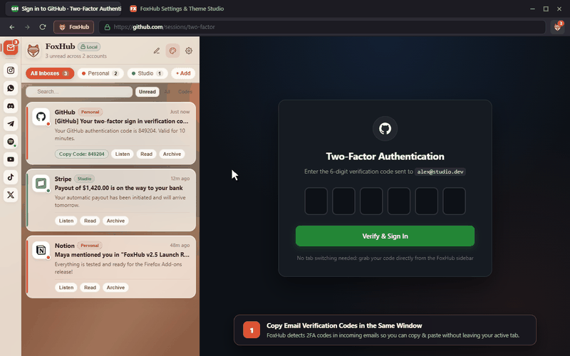

# FoxHub for Firefox

<p align="center">
  
</p>

**FoxHub** is a local multi-account Gmail inbox and social/media sidebar built for Firefox.

Instead of keeping ten pinned tabs open just to grab login verification codes, reply to messages, or scroll Reels while waiting on a match or a build, FoxHub keeps your inbox and web apps tucked cleanly in the Firefox sidebar right next to your active tab.



> Full high-res video: [`demo/foxhub-demo.mp4`](demo/foxhub-demo.mp4)

## Why I Built This

1. **Copying email verification codes in the same window:** Whenever a site asks for a 6-digit login code, FoxHub detects the code inside incoming emails and gives you a one-click **Copy** button right in the sidebar. You grab the code and paste it into the page next to it without switching tabs.
2. **Social & media apps that actually fit a sidebar:** Most desktop websites break or overflow horizontally when squeezed into a 380px sidebar. FoxHub automatically adapts the layouts for **Instagram** (Feed, Reels, DMs), **WhatsApp**, **Discord**, **Telegram**, **Spotify**, **YouTube**, **TikTok**, **X**, **Messenger**, and **Reddit**, and adds a clean bottom navigation bar for jumping between sections.
3. **Instant switching without losing your spot:** Active apps stay alive in the background while you switch between them, so Spotify keeps playing while you check Instagram or read an email.
4. **Security & privacy first (100% local, zero telemetry):** There are no external developer servers, no analytics scripts, and no data collection. Everything runs locally on your machine between Firefox and the sites you already use.

## Main Features

* **Multi-Account Gmail Support:** Automatically picks up all signed-in Firefox Google accounts (`u/0`, `u/1`, `u/2`, etc.) in a unified inbox or per-account tabs.
* **Quick Email Actions:** Read full email threads, copy 2FA codes in one click, reply, archive, delete, star, snooze locally, or listen to emails with Text-to-Speech.
* **10 Built-In Sidebar Apps + Custom URLs:** Instagram, WhatsApp, Discord, Telegram, Spotify, YouTube, TikTok, X, Messenger, and Reddit, plus the option to pin any custom web link.
* **8 Warm Themes & Custom Backgrounds:** Choose from 8 warm palettes (*Warm Linen, Botanical Sage, Sakura Morning, Coastal Breeze, Golden Hour, Lavender Cloud, Gallery Paper, Cozy Espresso*), illustrated wallpapers, or upload your own background image.
* **Acoustic Notification Chimes:** Local Web Audio notification chimes with volume control and Do Not Disturb mode.

## Privacy & Security

* **No Telemetry:** Zero tracking, zero usage metrics, and zero crash reporters.
* **No Middleman Servers:** Your emails and messages never pass through any third-party proxy or backend server.
* **Local Storage Only:** Preferences, themes, and local cache are stored strictly in Firefox's `browser.storage.local`. See [PRIVACY.md](PRIVACY.md) for details.

## How to Install

### Option 1: Load in Firefox Developer / Debugging Mode
1. Open Firefox and go to `about:debugging#/runtime/this-firefox`
2. Click **Load Temporary Add-on...**
3. Select [`manifest.json`](manifest.json) or [`foxhub-firefox.zip`](foxhub-firefox.zip) in this repository.

### Option 2: Install Packaged Add-on
Install directly from the packaged [`foxhub-firefox.zip`](foxhub-firefox.zip) archive via Firefox Add-ons.

## Project Structure

```text
├── icons/                  # Transparent warm FoxHub icons (16px to 128px + SVG)
├── src/
│   ├── background/         # Local Gmail polling, cookie/frame header handler, notifications
│   ├── popup/              # Sidebar & toolbar popup UI, multi-frame keep-alive deck
│   ├── options/            # Settings & Theme Studio
│   └── shared/             # Themes, sound synthesizer, Gmail client, sidebar layout optimizer
├── demo/                   # Demo video (.mp4) and preview (.gif)
├── manifest.json           # Firefox WebExtension manifest
├── PRIVACY.md              # Local-first privacy policy
└── LICENSE                 # MIT License
```

## Feedback & Feature Requests

If you have any feedback, run into a bug, or want to see a specific app or feature added, feel free to leave a review on the Firefox Add-ons rating page or open an issue right here on the GitHub repo. I read everything and actively update the extension based on what people actually use.

## License

Released under the [MIT License](LICENSE).
